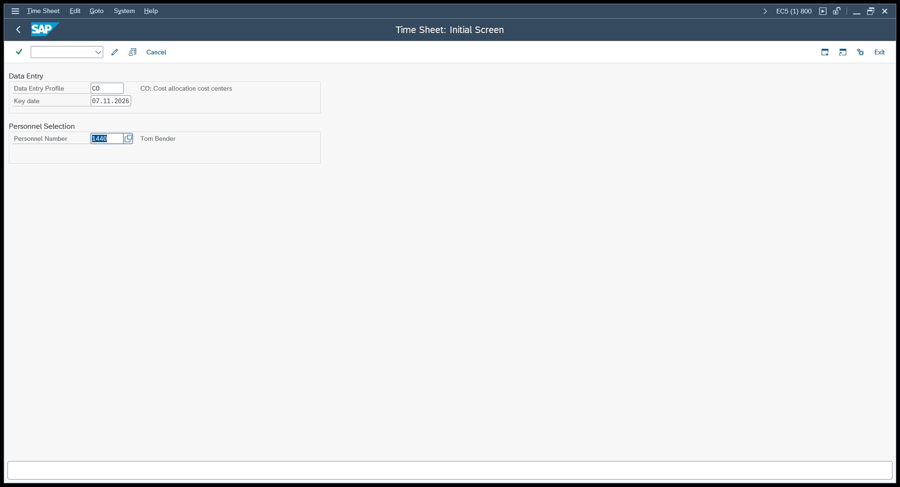
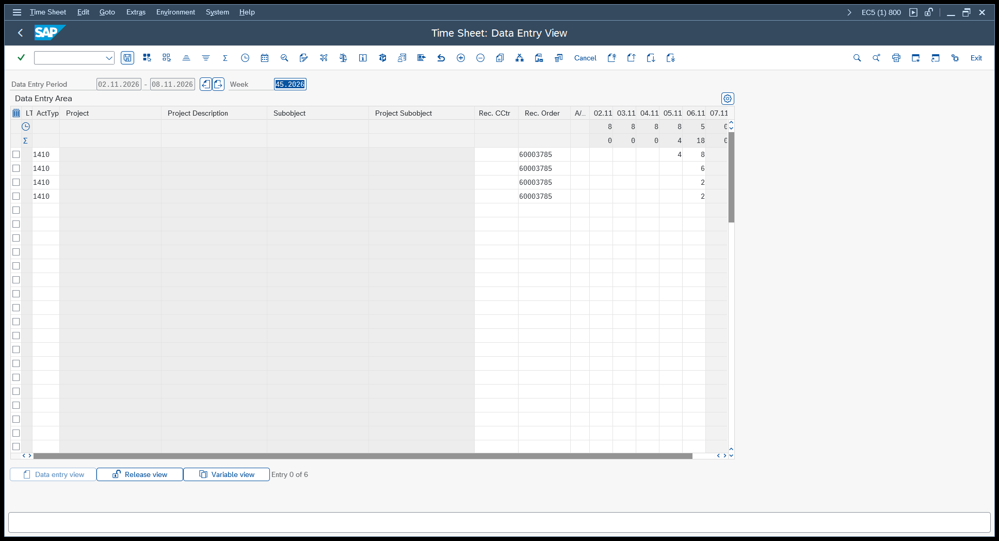
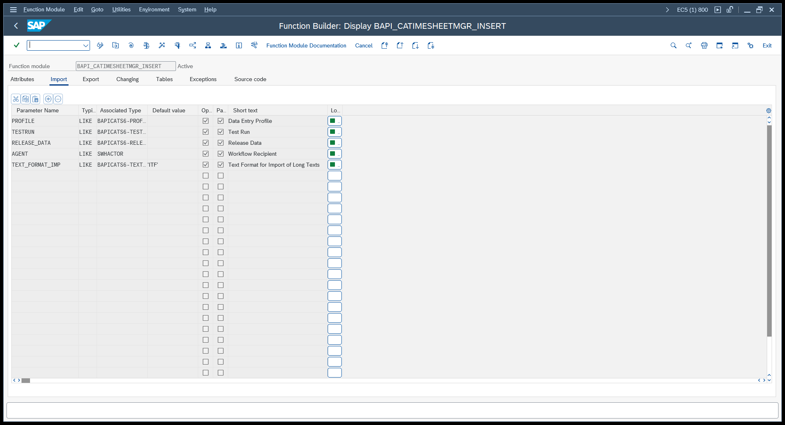
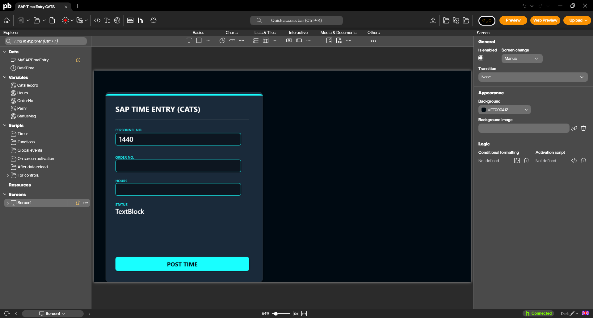
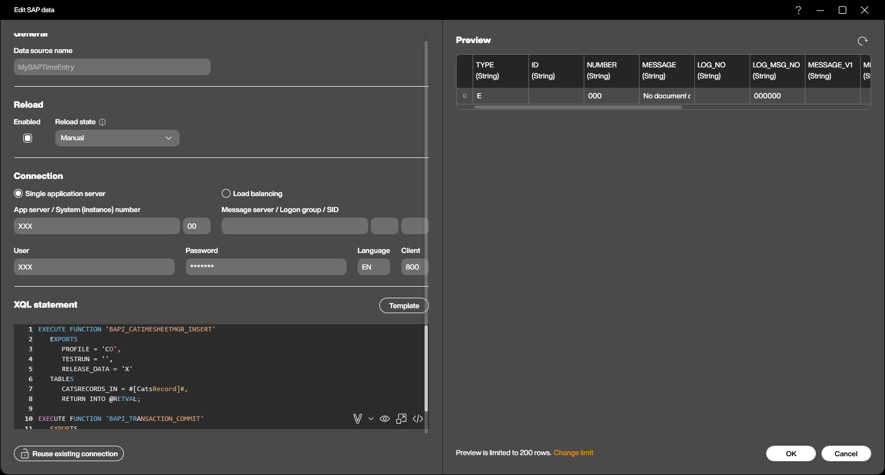
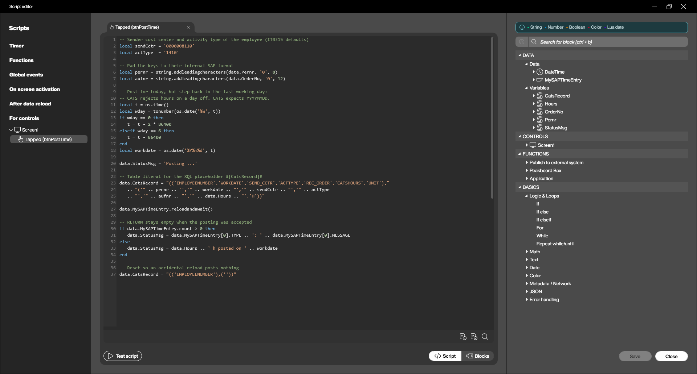

Every hour someone works on the shop floor has to end up somewhere in SAP. It has to land on the order, the project or the cost centre that caused it, otherwise the costing is wrong and nobody can tell what a part really costs to make. In SAP, the place where all of that comes together is CATS, the Cross-Application Time Sheet.

CATS is a single entry point for working times that are then distributed into whatever component needs them: HR for payroll and time management, CO for cost allocation, PS for project confirmations, PM and CS for service orders. The worker enters their hours once, and CATS takes care of the rest.

The standard way to enter those hours is transaction `CAT2`, and that works well for anyone sitting at a desk. On the shop floor it doesn't. Nobody walks to an office PC, logs into SAP and navigates a time sheet grid after every job. That is exactly the gap a Peakboard application fills: a terminal at the workstation, three fields, one button, and the hours are in SAP before the operator has put the part down.

In this article we build that terminal. We look at how a time entry works in `CAT2`, which BAPI does the same job over RFC, and how to wire it all up in the Peakboard Designer.

## How a time entry works in SAP

Everything in CATS starts with a **data entry profile**. The profile is a piece of customizing that decides what a time sheet looks like: which columns the user sees, which fields are mandatory, whether the hours are released immediately, and which receiver objects are allowed at all. A profile for a project member looks completely different from one for a maintenance technician, and that is the point.

When you start `CAT2`, SAP asks for exactly two things: the profile, and the personnel number of the employee whose times you want to record.


We use the standard profile `CO` - "CO: Cost allocation cost centers". It covers the classic case: an employee books hours from their own cost centre onto a receiver object, and the costs move along with them.

The entry screen itself is a grid. One row per receiver object, one column per day of the week. In our example the receiver is production order `60003785`, and the hours go into the column of the day they were worked.


Two pieces of master data have to exist before any of this works, and both of them bite the first time.

The employee needs infotype **0315** (*Time Recording Information*). This is where the sending cost centre and the activity type of the employee are stored, and CATS takes them as the defaults for every row. Without infotype 0315 the system refuses the entry with a message about a missing plant in the HR master record.

The combination of sending cost centre and activity type also needs a price in the fiscal year you are posting into - transaction `KP26`. An employee who was planned in 2017 but not in the current year gets rejected with the remark that a master record exists only in 2017. Neither message points at the real cause very clearly, so it is worth checking both before blaming the interface.

## The BAPI

SAP exposes the time sheet through `BAPI_CATIMESHEETMGR_INSERT`. It is released, RFC-enabled, and it does exactly what `CAT2` does when you press Save - including all the checks.


Three import parameters matter:

| Parameter | Meaning |
|---|---|
| `PROFILE` | The data entry profile, the same one you would type into `CAT2` |
| `TESTRUN` | `'X'` runs all checks but writes nothing - useful while you are developing |
| `RELEASE_DATA` | `'X'` releases the records right away instead of leaving them in status *saved* |

The hours themselves travel in the table `CATSRECORDS_IN`, which uses the structure `BAPICATS1`. That structure has a lot of fields, because it has to serve every receiver object CATS knows, but a cost allocation row only needs a handful:

| Field | Our value | Meaning |
|---|---|---|
| `EMPLOYEENUMBER` | `00001440` | Personnel number, padded to eight digits |
| `WORKDATE` | `20261106` | The day the work was done, as `YYYYMMDD` |
| `SEND_CCTR` | `0000008110` | Sending cost centre, from infotype 0315 |
| `ACTTYPE` | `1410` | Activity type, from infotype 0315 |
| `REC_ORDER` | `000060003785` | Receiver - here a production order, padded to twelve digits |
| `CATSHOURS` | `2` | Number of hours |
| `UNIT` | `H` | Unit of the hours |

The result comes back in the `RETURN` table, in the usual BAPI message structure. An empty table means the record went through without a single remark. If something is wrong, the table carries the message, and the message type tells you how bad it is: `E` means nothing was posted, `W` means the record is in but SAP wants you to know something.

One last thing, and it is the classic BAPI trap: the module does not commit. Without a following `BAPI_TRANSACTION_COMMIT`, the record never reaches the database - just like the status change in our [Kanban article](/From-Empty-to-Full-How-to-Fire-SAP-Kanban-Events-from-a-Peakboard-Box.html).

## Building the Peakboard application

The sample application is available for download at the top of this article. The SAP connection in it is anonymized, so enter your own system and user before you try it.

The structure is deliberately small. One SAP data source called `MySAPTimeEntry`, and five variables: `Pernr`, `OrderNo` and `Hours` are bound to the three text boxes, `StatusMsg` is bound to the text block under *STATUS*, and `CatsRecord` carries the time record to SAP.


### One record, hard-coded

Before we make anything configurable, it helps to write the call exactly as it will be sent to SAP. Both function calls go into one XQL script - all statements in a script share the same RFC session, so the commit applies to the insert right above it:

```sql
EXECUTE FUNCTION 'BAPI_CATIMESHEETMGR_INSERT'
   EXPORTS
      PROFILE = 'CO',
      TESTRUN = '',
      RELEASE_DATA = 'X'
   TABLES
      CATSRECORDS_IN = (('EMPLOYEENUMBER','WORKDATE','SEND_CCTR','ACTTYPE','REC_ORDER','CATSHOURS','UNIT'),
                        ('00001440','20261106','0000008110','1410','000060003785','2','H')),
      RETURN INTO @RETVAL;

EXECUTE FUNCTION 'BAPI_TRANSACTION_COMMIT'
   EXPORTS
      WAIT = 'X'
```

That is the whole posting: two hours for employee 1440 on 6 November, from cost centre 8110 with activity type 1410, onto production order 60003785.

The shape of `CATSRECORDS_IN` is worth a close look, because it is how XQL writes any table parameter. The outer brackets hold a list of rows. The **first row is the header** and carries the column names, every row after it is one record - here exactly one, but you could append more rows and post a whole week in a single call. The values are all strings in single quotes, in the same order as the header, and they are the internal SAP representations: the personnel number padded to eight digits, the order number to twelve, the date as `YYYYMMDD`.

`RETURN INTO @RETVAL` points the other way. It takes the message table coming back from SAP and turns it into the rows of the data source, which is how we get SAP's answer onto the screen later on.

You can paste this statement into the data source as it stands and hit refresh in the preview, and the hours land in SAP. That is a good place to stop and verify everything - profile, infotype 0315, the activity price - before a single line of script exists. Just remember that every refresh posts another record.

### The same call, made generic

A hard-coded record is of course useless on a real terminal, where the operator decides what gets posted. So we replace the whole table literal with a placeholder:

```sql
EXECUTE FUNCTION 'BAPI_CATIMESHEETMGR_INSERT'
   EXPORTS
      PROFILE = 'CO',
      TESTRUN = '',
      RELEASE_DATA = 'X'
   TABLES
      CATSRECORDS_IN = #[CatsRecord]#,
      RETURN INTO @RETVAL;

EXECUTE FUNCTION 'BAPI_TRANSACTION_COMMIT'
   EXPORTS
      WAIT = 'X'
```

`#[CatsRecord]#` is a Peakboard variable, and Peakboard substitutes its content into the statement as plain text right before the call is sent to SAP. In other words, whatever string sits in `CatsRecord` at that moment takes the place of the placeholder - so if the variable holds

```
(('EMPLOYEENUMBER','WORKDATE','SEND_CCTR','ACTTYPE','REC_ORDER','CATSHOURS','UNIT'),('00001440','20261106','0000008110','1410','000060003785','2','H'))
```

then SAP receives character for character the same statement we wrote by hand above. Nothing clever happens in between; the only difference is who writes that text.

Set the reload state to **Manual**. Every reload posts hours in SAP, so this data source must never run on a timer. For the same reason, `CatsRecord` has the default value `(('EMPLOYEENUMBER'),(''))`: a table with a single empty row. If the data source ever reloads by accident, the BAPI finds no personnel number and answers with an error instead of booking anything. The preview in the screenshot shows exactly that case.


### Building the record in a script

Writing that text is the job of the `Tapped` script of the **POST TIME** button, which also reads SAP's answer afterwards:

```lua
-- Sender cost center and activity type of the employee (IT0315 defaults)
local sendCctr = '0000008110'
local actType  = '1410'

-- Pad the keys to their internal SAP format
local pernr = string.addleadingcharacters(data.Pernr, '0', 8)
local aufnr = string.addleadingcharacters(data.OrderNo, '0', 12)

-- Post for today, but step back to the last working day:
-- CATS rejects hours on a day off. CATS expects YYYYMMDD.
local t = os.time()
local wday = tonumber(os.date('%w', t))
if wday == 0 then
   t = t - 2 * 86400
elseif wday == 6 then
   t = t - 86400
end
local workdate = os.date('%Y%m%d', t)

data.StatusMsg = 'Posting ...'

-- Table literal for the XQL placeholder #[CatsRecord]#
data.CatsRecord = "(('EMPLOYEENUMBER','WORKDATE','SEND_CCTR','ACTTYPE','REC_ORDER','CATSHOURS','UNIT'),"
   .. "('" .. pernr .. "','" .. workdate .. "','" .. sendCctr .. "','" .. actType
   .. "','" .. aufnr .. "','" .. data.Hours .. "','H'))"

data.MySAPTimeEntry.reloadandawait()

-- RETURN stays empty when the posting was accepted
if data.MySAPTimeEntry.count > 0 then
   data.StatusMsg = data.MySAPTimeEntry[0].TYPE .. ': ' .. data.MySAPTimeEntry[0].MESSAGE
else
   data.StatusMsg = data.Hours .. ' h posted on ' .. workdate
end

-- Reset so an accidental reload posts nothing
data.CatsRecord = "(('EMPLOYEENUMBER'),(''))"
```

Three details are worth a word. `string.addleadingcharacters()` pads the personnel number and the order number to their internal SAP length - CATS stores them that way, and a short key simply does not match. The weekday check exists because CATS validates the date against the employee's work schedule and refuses hours on a day off; on a real terminal you would take the date from the order confirmation instead of from the clock. And `reloadandawait()` reloads synchronously, so the lines below are guaranteed to see the answer to this call and not the one from the previous tap.


## Trying it out

Start the preview, enter a personnel number, an order number and the hours, and tap **POST TIME**. A moment later the status line shows what SAP had to say.


The screenshot shows a warning rather than silence, and that is not a failure: `W: Number of hours recorded 18,00 exceeds target hours 5,00`. Our test employee already had plenty of hours on that day, so the total went well past the daily target of the work schedule. The record was posted anyway - a `W` is a remark, not a rejection. This is exactly why the script looks at the message type instead of assuming the best: an `E` would mean nothing reached the database at all.

To check the result on the SAP side, open `CAT2` again with the same profile and personnel number, or look into table `CATSDB`, where every time sheet record lives together with its status.

## Wrapping up

Three fields and a button, and the hours are in SAP, on the right order, with the right cost centre and activity type behind them. No office PC, no time sheet grid, no re-typing in the evening.

From here the obvious step is to get rid of the typing altogether. The personnel number comes from the badge the operator scans or holds against an RFID reader at the terminal, the order number comes from the order the station is currently running, and the hours come from the time between start and finish, which Peakboard can measure for you - have a look at [Mind the Gap](/Mind-the-Gap-How-to-Calculate-Time-Between-Events-in-Peakboard.html) for that part. What is left is a single button that says "done", and the time sheet fills itself.
