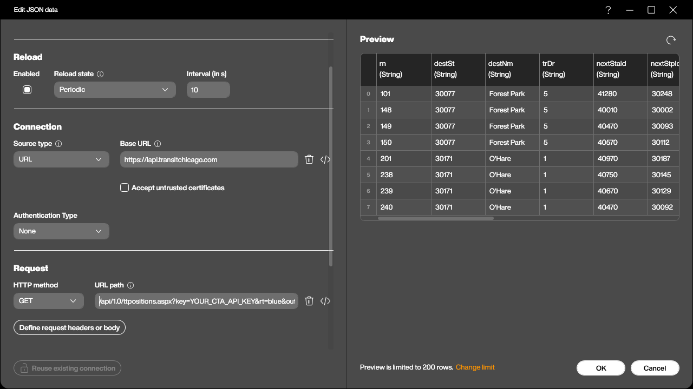
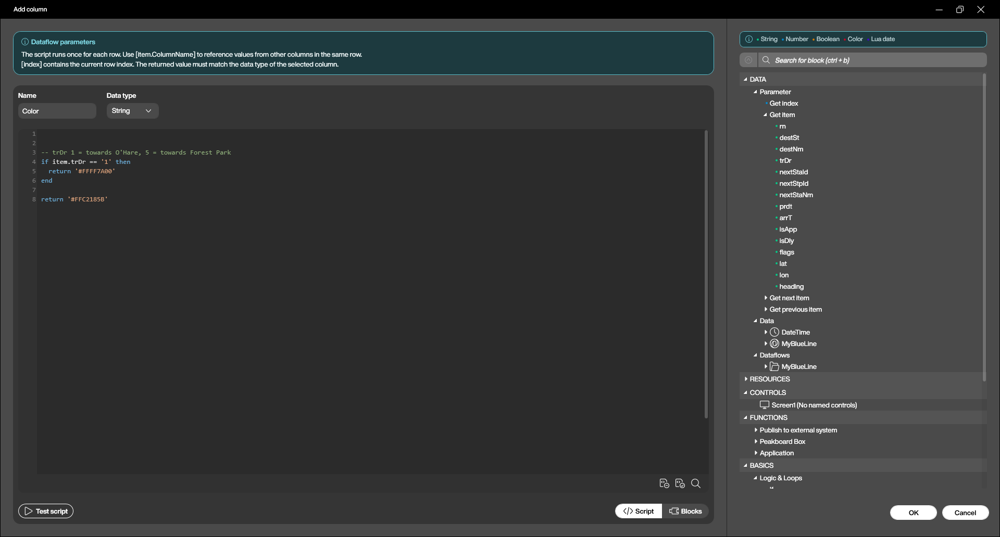
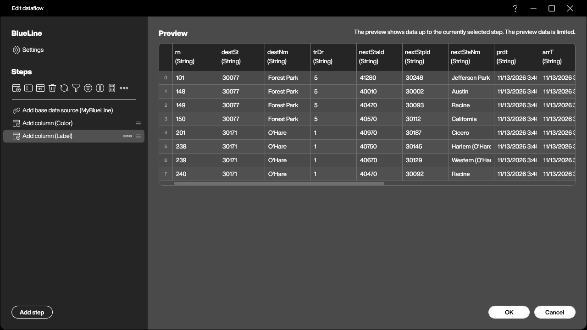
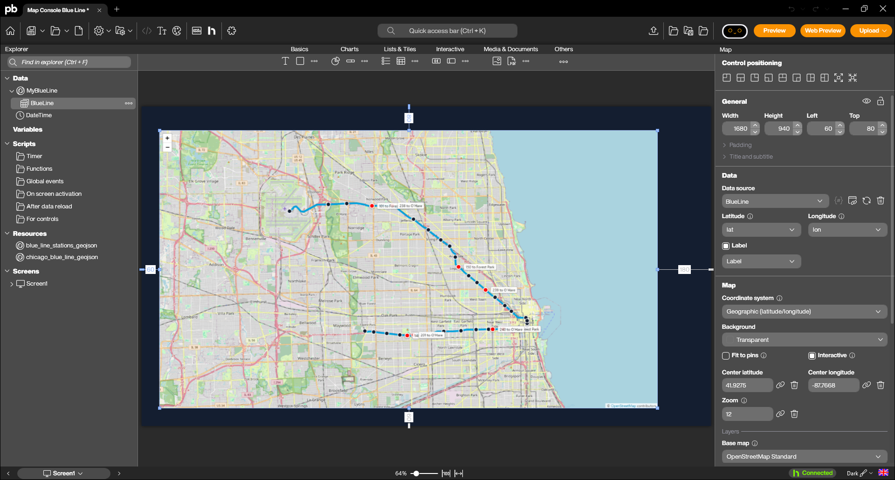
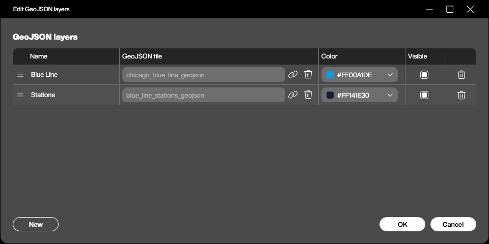
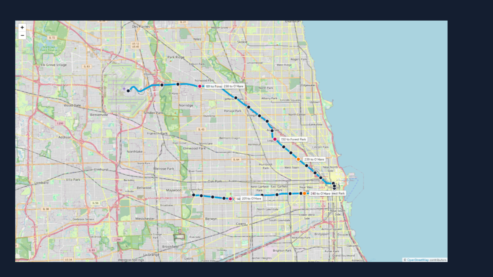

Most of what we put on a dashboard answers *how much* or *how long*. A map answers a different question, and it is one that tables are terrible at: *where*. Where is the forklift, where is the truck, where is the technician, where is the shipment right now. The moment the answer is a position rather than a number, a list of coordinates in a table is close to useless, and a dot on a map is understood in half a second.

Peakboard has a map control for exactly that, and it does rather more than drop pins on a world map. In this article we take a tour of what it can do, and then we build something that shows most of it at once: a live map of the Chicago Blue Line, with the track and all its stations drawn underneath and the actual trains moving across it, fed by the public API of the Chicago Transit Authority.

## What the map control can do

The control is made of three layers that are configured independently, and the trick to using it well is to keep them apart in our heads.

**The base map** is the picture underneath. Out of the box it offers OpenStreetMap Standard, the Humanitarian style, OpenTopoMap and CyclOSM; all of them pull their tiles from the internet. A custom tile server URL in the form `https://tiles.example.com/{z}/{x}/{y}.png` is also accepted, and for a board that gets heavy use that is the polite option, because the OpenStreetMap tile usage policy does not cover heavy traffic. The last choice is the interesting one: **None**. With no base map, nothing at all is loaded from the internet and the map draws only its own layers. That is what makes an offline hall plan on a shop floor without internet access possible, and it is the same control, not a different one.

**The pins** come from a data source. We name a column for latitude and one for longitude, in decimal degrees, and optionally one for the label and one for the colour. Every row becomes a pin, rows with invalid coordinates are skipped, and that is the whole contract. There is no pin designer and no per-pin dialog; whatever the data source delivers is what is on the map. A tapped pin fires the `PinTapped` event with the row index of the pin, so a tap can look the row up and show a detail card next to the map.

**The GeoJSON layers** are drawn on top of the base map and under the pins. GeoJSON is the lingua franca for geometry: points, lines and areas in a plain JSON file, which means every GIS tool on earth exports it, every open data portal offers it, and a hand-drawn hall layout can be written in a text editor if it has to be. Layers can come from the resources of the application, and scripts can add more at runtime with `addgeojsonlayer()`, replace them by adding the same name again, or drop them with `removegeojsonlayer()` and `cleargeojsonlayers()`.

Add the pieces together and the range of what is possible gets wide quickly. The zoom goes from 1, the whole planet, to 24, which is detail inside a single room, and the control can work in plan coordinates instead of geographic ones, so a floor plan with its own origin and its own scale in metres is a legitimate map. Pins in such a plan are AGVs, pallets or people rather than delivery vans. Areas drawn as GeoJSON become zones, and the control raises events when something enters or leaves one, which is a geofence by another name.

For our tour we stay outdoors, because there is a data source out there that is more fun than anything we could fake.

## The CTA API in brief

The Chicago Transit Authority runs the rapid transit network that everyone in the city calls the L, and it publishes a **Train Tracker API** that reports where its trains are, right now. It is free, it needs a key, and the key arrives by mail after a short registration on the CTA developer site. There is a rate limit, and the terms ask that we stay reasonable, which we will.

The call we need is one single URL:

```
https://lapi.transitchicago.com/api/1.0/ttpositions.aspx?key=<our key>&rt=blue&outputType=JSON
```

Three parameters do the work. `key` is the API key, `rt` names the route by its colour (`red`, `blue`, `brn`, `g`, `org`, `p`, `pink`, `y`), and `outputType=JSON` asks for JSON instead of the XML that the API otherwise returns. Several routes can be named at once, separated by commas.

What comes back is a small envelope around a list of trains:

```json
{"ctatt":{"tmst":"2026-11-13T04:03:58","errCd":"0","errNm":null,
  "route":[{"@name":"blue","train":[
    {"rn":"101","destSt":"30077","destNm":"Forest Park","trDr":"5",
     "nextStaId":"40590","nextStpId":"30116","nextStaNm":"Damen",
     "prdt":"2026-11-13T04:03:25","arrT":"2026-11-13T04:04:25",
     "isApp":"1","isDly":"0","flags":null,
     "lat":"41.9131","lon":"-87.68265","heading":"123"}
  ]}]}}
```

The fields worth knowing for a dashboard are few. `rn` is the run number, the identity of that particular train for the day. `destNm` is where it is going and `trDr` is the direction as a code, `1` for one end of the line and `5` for the other. `nextStaNm` and `arrT` are the next station and the predicted arrival there, `isApp` says the train is approaching it and `isDly` that it is not moving as it should. And then the three that make this an article about maps: `lat`, `lon` and `heading`.

One detail decides how the rest of the application looks: the list holds **one row per train that is currently running**, and nothing else. There is no row for a train that is parked, and the number of rows changes from call to call as trains start and finish their runs. That suits the map control perfectly, because pins are exactly as transient as the rows behind them.

## The data source

In the Designer this is an ordinary JSON data source on a URL connection pointing at `https://lapi.transitchicago.com`. The path with its three parameters goes into the data source, the JSON path `ctatt.route[0].train` picks the train array out of the envelope, and the columns come straight from the preview.



Every column arrives as a string, `lat` and `lon` included, and that is fine; the map control parses them itself. The reload state is **Periodic** at ten seconds, which keeps the pins moving without hammering the API. Polling faster would not help, because the trains do not report their position any faster than that.

## The dataflow

The map wants a colour column and a label column, and the API delivers neither. Building them is a job for a dataflow sitting on top of the JSON source, and the whole flow is two added columns.

The first is **Color**, and this is where the direction code earns its keep:

```lua
-- trDr 1 = towards O'Hare, 5 = towards Forest Park
if item.trDr == '1' then
  return '#FFFF7A00'
end

return '#FFC2185B'
```



The second is **Label**, the text that rides along next to each pin:

```lua
return item.rn .. ' to ' .. item.destNm
```



The reload state of the dataflow is **Triggered by source**, so every time the JSON source brings fresh positions, the two columns are rebuilt and the map redraws. Nothing else needs to be wired.

It is worth noticing what this buys us. Two trains sitting at the same platform, one heading for O'Hare and one for Forest Park, are visibly different objects on the screen, and the difference was five lines of Lua in a dataflow rather than anything on the map itself.

## The map control

Now the control goes on the screen and the data source goes into it. `Source` points at the dataflow, `Latitude` and `Longitude` at the `lat` and `lon` columns, `Label` and `Color` at the two we just built.



The rest is framing. The centre is set near the middle of the line and the zoom to 12, which fits the Blue Line from O'Hare in the north-west to Forest Park in the west on one screen. **Fit to pins** stays off on purpose: it would reframe the map on every reload as trains appear and disappear, and a map that jumps around every ten seconds is unreadable. The pin style is **Point**, a plain dot rather than the classic needle pin, because at this zoom a needle covers half a neighbourhood, and the pin size is 36 so that a train is clearly bigger than a station.

## Two GeoJSON layers

Pins on a plain street map would already work, but the result tells only half the story: the dots are visibly in Chicago, and that is all. What makes it a transit map is the geometry underneath, and that is where the two GeoJSON layers come in.

The city of Chicago publishes both pieces on its open data portal: the geometry of the elevated and subway tracks, and the list of all L stops with their coordinates. Both are available as GeoJSON, and both cover the whole network, so the only real work is filtering out the Blue Line.

The first layer, `chicago_blue_line.geojson`, holds the 34 track segments of the line as `MultiLineString` features. The second, `blue_line_stations.geojson`, holds its 33 stations as points. The stops file lists one entry per platform, so a station with trains in both directions appears twice; collapsing them by their station id is what turns 66 platform rows into 33 station dots.

Both files go into the resources of the application and are then added as layers on the map control, each with its own colour.



Two things about GeoJSON in this control are worth writing down, because both of them cost us time.

**Features can carry their own style.** The layer colour in the properties applies to everything in the file, but any feature that brings its own `stroke`, `stroke-width`, `fill` or `marker-color` keeps it. These are the simplestyle conventions that many tools already write, and they let a single file contain, for example, a red zone and a green one.

```json
{
  "type": "Feature",
  "properties": { "station": "Damen", "marker-color": "#141E30" },
  "geometry": { "type": "Point", "coordinates": [-87.67584, 41.909212] }
}
```

**A property called `name` becomes a permanent label.** The control looks for `name`, `title` or `label` on every feature and, if it finds one, draws it on the map as a label that never goes away. With 33 stations that produced a wall of white boxes which completely covered the track along the stretch where the line runs east to west, and the map looked broken rather than busy. Renaming the property to `station` solved it in one edit: the name is still in the file for anything that wants to read it, and the map stays clean.

## The result

The application reloads every ten seconds, and the trains crawl along the line in both directions, orange towards O'Hare and magenta towards Forest Park, with their run number and destination next to them.



It is worth watching for a minute. Trains bunch up on the approach to the Loop, the gaps on the Forest Park branch are visibly longer than on the O'Hare side, and every so often a pin disappears because the run has ended. None of that is in the data as a number, and all of it is obvious on the map.

## Wrapping up

The map control turned out to be three simple ideas that stack: a base map, pins from a data source, and GeoJSON on top. Everything interesting happens in how they are combined. The data source and the dataflow in this sample are the same kind of plumbing we would build for a table, and the geometry is a file from an open data portal that we filtered once and never touched again.

Which is also the reason this translates so directly to the shop floor. Swap the CTA API for the positions of forklifts from a fleet system, swap the Blue Line track for the GeoJSON of a hall layout, switch the base map to None, and the same three layers become an indoor map of a plant that needs no internet connection at all. The trains were only the most entertaining way to show it.

The whole sample is available for download at the top of this article, together with the two GeoJSON files. The API key in the sample is a placeholder, so a key of our own is the only thing needed to see the trains move.
