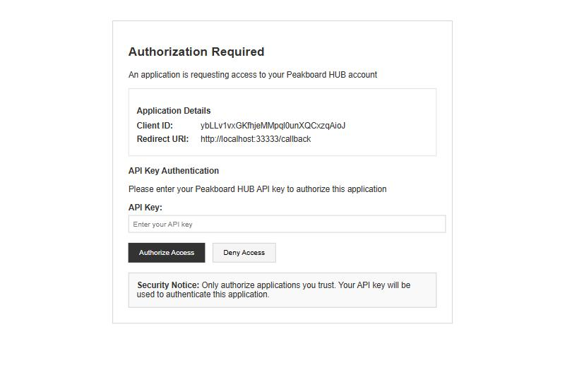
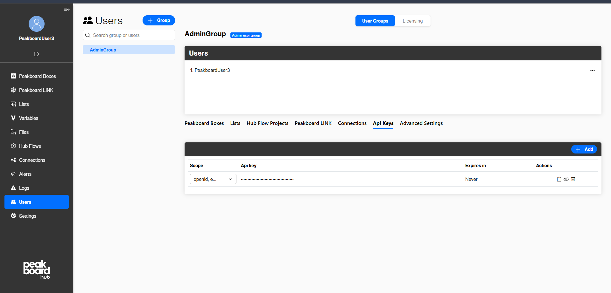

An AI assistant on its own is a very well read colleague who has never been to the plant. It can explain what a Kanban loop is, but it has no idea whether the box in hall 2 is online, which line stopped this morning, or what is currently in the shared variable list that feeds the shift board. Everything it knows about our world is whatever we paste into the chat window.

The Model Context Protocol closes exactly that gap, and since Hub 2.3 the Peakboard Hub speaks it. This article is a short introduction to what MCP actually is, followed by a step by step walk through connecting the Hub to an AI assistant. The authentication is the part most worth reading slowly, because it is the part that decides what the assistant is allowed to touch.

## What MCP is, in one section

MCP is an open protocol that lets an AI application call tools on a server in a structured way. The server publishes a list of tools; each one has a name, a description, and a JSON schema for its parameters. The client asks for that list, shows the model what is available, and when the model decides to use one, the client sends a call and feeds the result back into the conversation. The wire format is plain JSON-RPC, either over standard input and output for a local process, or over HTTP for something on the network. That is the whole idea.

What makes it interesting is that it is one protocol rather than one integration per product. An assistant that can speak MCP can talk to anything with an MCP server in front of it, and a product that ships an MCP server is reachable from every assistant that speaks it, without either side knowing about the other in advance.

That second half is no longer a promise, it is simply how the tooling looks now. Claude and Claude Code speak MCP, and so do the open agents that have grown up around it: **Hermes**, the agent from Nous Research, carries a built-in MCP client that handles both local processes and HTTP servers, and **OpenClaw** registers its servers in a configuration file and hands the resulting tools to its agents, with an allowlist deciding which agent may touch which tool. The walk through below uses Claude because it is the shortest to write down, but nothing in it is specific to Claude. Every step after the URL is the protocol doing its work, and the same Hub endpoint answers whichever agent is asking.

For the Hub that means the assistant stops guessing. It can ask which boxes exist, read a list, start a hub flow, send an alert. And because it is a protocol rather than a chat trick, every one of those calls goes through the Hub's normal permission model instead of around it.

## What the Hub exposes

The MCP server lives in the Hub's public API component, which listens on port **20688** by default, next to the web interface on 20588. Both are set in the `appsettings.json` of their installation folders. The endpoint itself is one URL:

```
http://<our-hub>:20688/mcp
```

Asked for its tools, the server currently answers with 24 of them, grouped neatly along the Hub's own furniture:

| Area | Tools |
|---|---|
| Peakboard Boxes | `get_boxes`, `get_box_screenshot`, `get_box_variables`, `update_box_variable`, `get_box_lists`, `add_box_list_record`, `update_box_list_record`, `delete_box_list_record`, `get_box_global_functions`, `run_box_global_functions` |
| Shared variable lists | `get_lists`, `get_list`, `get_list_by_sql`, `add_list_record`, `update_list_record`, `delete_list_record` |
| Hub Flows | `get_hubflow_projects`, `get_hubflow_list_data`, `run_hubflow` |
| Files | `list_files`, `get_file`, `delete_file` |
| Alerts | `get_alerts`, `send_alert` |

The descriptions are short and the schemas are exactly what the REST API already uses. `run_hubflow`, for example, takes a `hubFlowId` and optionally a trigger function name with its parameters, and `get_list` takes a list name plus the usual sorting, paging and format arguments. Nothing new had to be invented; the MCP layer is a second doorway into the public API rather than a parallel implementation of it.

That also sets expectations about what this is good for. It is not a way to design dashboards by chat. It is a way to let an assistant read the state of a Peakboard landscape and act on it in the same ways a script or an integration already could.

## Authentication, which is the interesting half

Here is the part that deserves care. The endpoint is not protected by a static token in a config file. It is a full OAuth 2.1 protected resource, and the flow is worth understanding before setting it up, because almost all of it happens without us.

A request without a token gets a 401 and, more usefully, a header that says where to learn the rules:

```
WWW-Authenticate: Bearer realm="mcp",
  resource_metadata="http://<our-hub>:20688/.well-known/oauth-protected-resource",
  scope="openid email profile offline_access read:lists write:lists read:alerts
         write:alerts read:box write:box read:hubflows write:hubflows
         read:files write:files"
```

Following that metadata document leads to the authorization server, which is the Hub itself, and its own document at `/.well-known/oauth-authorization-server` lists everything a client needs: an authorization endpoint, a token endpoint, a revocation endpoint, and a registration endpoint. Three details in there matter.

First, **the client registers itself**. There is no client ID to create by hand in the Hub. The assistant posts its name and redirect URI to `/oauth/register` and gets a client ID back. Second, **PKCE is mandatory** and only `S256` is accepted, and clients are public, so no client secret is issued or expected. Third, **redirect URIs must point at localhost or at an HTTPS address**, which quietly rules out a plain HTTP callback from somewhere else on the network.

So far, no human has been involved. The human part is the next step, and it is where the Peakboard Hub does something slightly unusual: the authorization page does not ask for a user name and a password. It asks for an **API key**.



The page names the application that is asking and the redirect URI it will return to, and warns, quite rightly, to authorize only applications we trust. The API key is what identifies us, and more importantly, the API key is what carries the **scopes**. The Hub logs it plainly: the scopes of the issued token come from the key, and when the assistant later asks for the tool list, every tool whose required scope is missing is silently filtered out of the answer. A key with only `read:box` produces an assistant that can see boxes and cannot write to a single list, and the model never even learns that the other tools exist.

The ten scopes come in read and write pairs over five areas, matching the table above: `lists`, `alerts`, `box`, `hubflows` and `files`. This is the real control surface, and it is worth spending a minute on rather than handing out everything by habit.

Where do those keys come from? From the Hub, under **Users**, on the user group, in the **Api Keys** tab.



A new key is created with the Add button, with its scopes picked from the same list and an expiry in days. The key belongs to the user group, so everything the assistant does, it does with that group's reach into the landscape, not with ours personally. Existing keys can be shown, copied, re-scoped or deleted here at any time, and deleting one cuts off whatever was using it.

What finally comes back from the token endpoint is an access token valid for one hour, plus a refresh token when `offline_access` was requested, so the assistant renews quietly in the background rather than asking again every hour. Worth knowing for the moment when access has to stop: deleting the key in the Hub is what really closes the door, and an access token already in flight still runs until its hour is up.

## Setting it up, step by step

With the mechanics understood, the actual setup is short.

**Step 1: create the API key.** In the Hub, open Users, select the user group the assistant should act as, switch to the Api Keys tab, press Add, tick the scopes it really needs, set an expiry, and copy the key. Treat it like a password from this moment on.

**Step 2: add the server to the assistant.** In Claude Code this is one line:

```bash
claude mcp add --transport http peakboard-hub http://<our-hub>:20688/mcp
```

Nothing else goes into that command. No key, no client ID, no secret. Everything else is discovered.

**Step 3: authenticate.** The first time the assistant talks to the server it gets the 401, reads the metadata, registers itself, and opens the Hub's authorization page in a browser. We paste the API key, press Authorize Access, and the browser hands the authorization code back to the waiting client, which exchanges it for a token. From here on the assistant holds the token and refreshes it on its own.

**Step 4: check that it worked.** The honest test is to ask for something only the Hub can know. Asking which Peakboard Boxes exist produces a `get_boxes` call and an answer along these lines:

```json
[
  { "Name": "line-01",  "BoxID": "PB1001", "State": "Running",
    "RuntimeVersion": "4.4.0.5", "BoxGroup": "Plant 1" },
  { "Name": "shipping", "BoxID": "PB1002", "State": "Failed",
    "RuntimeVersion": "4.4.0.5", "BoxGroup": "Plant 1" }
]
```

That is the moment the assistant stops being a well read colleague who has never visited, and starts being one who can look.

A caveat on where the client runs. A desktop or command line assistant on our own network reaches `http://hub:20688/mcp` directly, and localhost redirect URIs are explicitly allowed, so a local setup works as it stands. An assistant running in somebody's cloud cannot reach a hub inside the plant network at all, and the redirect rule means the Hub needs to be published over HTTPS with a real certificate before that becomes an option. For a first look, the local route is the one to take.

## Trying it without an assistant

Because it is all ordinary HTTP, the protocol can be driven by hand, which is a good way to see what the assistant sees. After the token exchange, two calls are enough. The first one opens a session:

```bash
curl -s http://<our-hub>:20688/mcp \
  -H "Authorization: Bearer <token>" \
  -H "Content-Type: application/json" \
  -H "Accept: application/json, text/event-stream" \
  -d '{"jsonrpc":"2.0","id":1,"method":"initialize","params":{
        "protocolVersion":"2025-06-18","capabilities":{},
        "clientInfo":{"name":"curl","version":"1.0"}}}'
```

The Hub answers as `Peakboard Hub API` on protocol version `2025-06-18` and returns an `Mcp-Session-Id` header to send along with everything that follows. The second call, `tools/list`, returns the tool catalogue, already filtered to the scopes behind our key. Both headers in that request matter: without `Accept: application/json, text/event-stream` the server rejects the call outright, which is the first thing to check when a hand-written client gets nowhere.

## Three places where this earns its keep

A tool list is not a reason to do anything. These three are, and each one leans on a different corner of the Hub.

**The shift handover.** A fair amount of what the Hub already holds exists so that the next shift knows what happened: the downtime records behind an Andon board, the entries in a digital shift book, the alerts that were raised overnight. Reading all of that at seven in the morning is a chore, and it is exactly the kind of chore a model is good at. An agent with `read:alerts` and `read:lists` can pull the night's alerts with `get_alerts`, read the downtime list with `get_list`, and produce the two paragraphs a shift lead actually wants: what stopped, how long for, and what is still open. The underlying boards do not change at all; the agent is simply a second reader of the same lists.

**Ordering a transport without leaving the conversation.** Several of the logistics boards work off a list that somebody fills in: the order list where a worker asks intralogistics for missing parts, the driving orders behind a forklift dispatch board. A list entry is a list entry whether a touchscreen or an agent writes it, so an agent holding `write:lists` can take "station 4 is running out of M8 washers" and turn it into a record through `add_list_record`, which lands on the forklift terminal like any other order. Where the work is already wrapped in a hub flow, `run_hubflow` starts that flow instead, parameters and all. This is the point where scopes stop being paperwork: an agent that can write orders is an agent that can create real work in the warehouse, and that is a decision to make deliberately.

**Looking after the boards themselves.** Once a landscape has grown past a handful of screens across several sites, the dull question is which of them are actually fine. `get_boxes` answers that in one call, with state and runtime version per box, and `get_box_screenshot` goes one better by fetching what a box is really showing, which settles the classic argument about whether a display is frozen or merely boring. For a first-level support agent that is a complete job description, and it needs nothing beyond `read:box`.

What the three have in common is worth noticing. None of them is "build me a dashboard". They are all cases where the data or the action already exists in the Hub and the slow part was a human walking to a screen, opening a list, or reading something at an inconvenient hour.

## Wrapping up

MCP in the Hub is a small feature with a wide blast radius, in a good way. There is one new URL, no new data model, and no new permission system, because the API key and its scopes were already the Hub's way of answering "who is allowed to do what". An assistant simply becomes another client of the public API, with the pleasant difference that nobody has to write the integration first.

The careful part is the key. The temptation is to create one with every scope ticked, because then everything works on the first try. The better habit is a key per purpose with the smallest set of scopes that does the job and an expiry that forces the question again later. The tool list the model sees is built from exactly those scopes, so a narrow key does not just block the dangerous calls, it hides them. That is a rare case of the safe option also being the simpler one.
