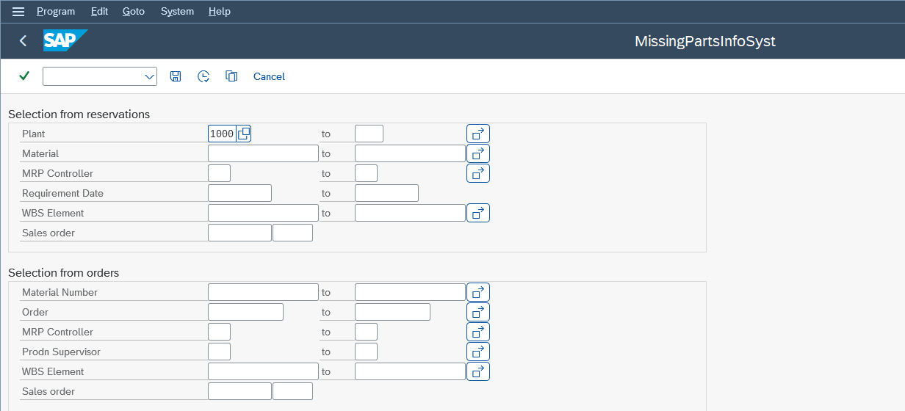
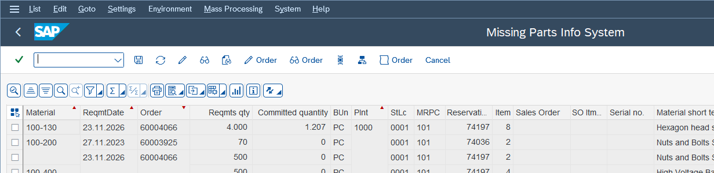
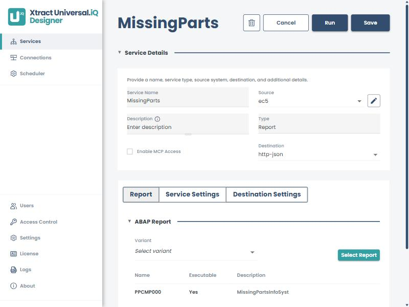
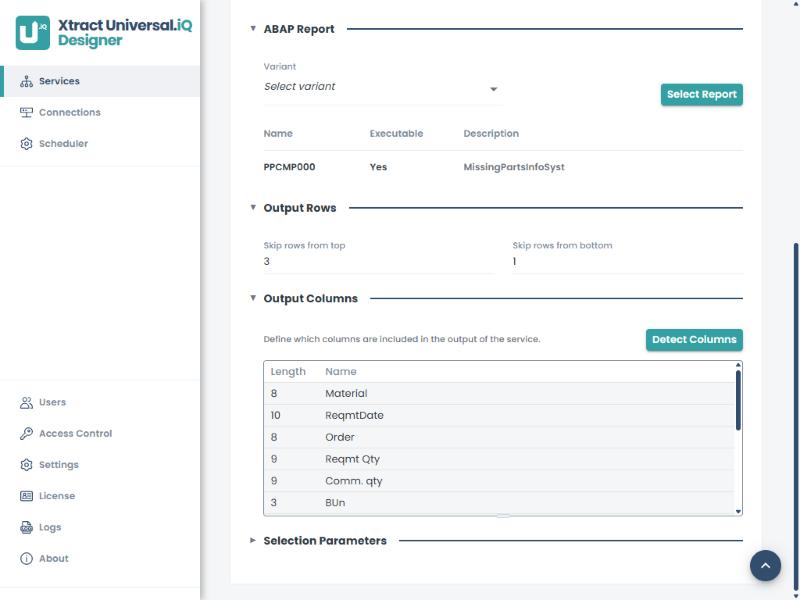
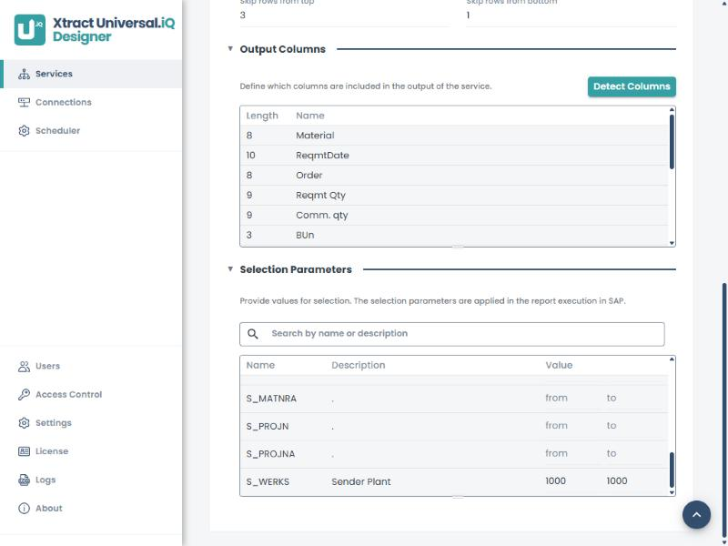
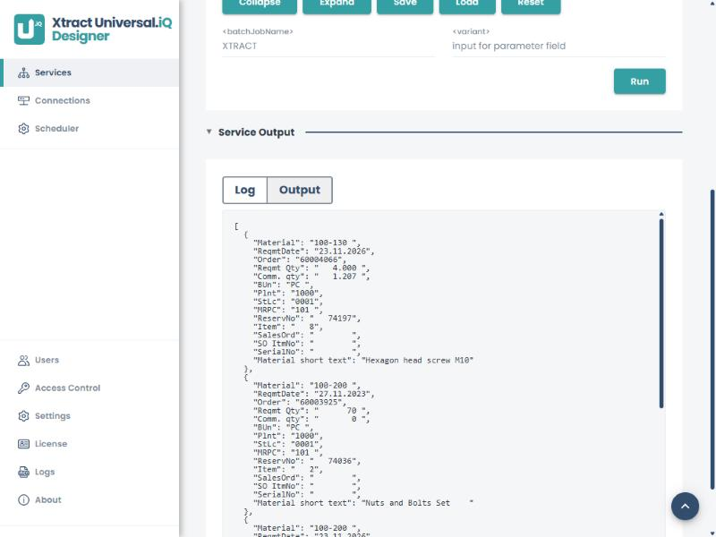
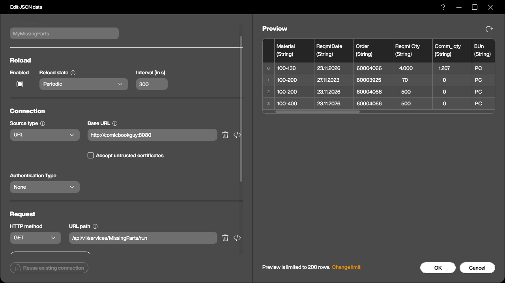
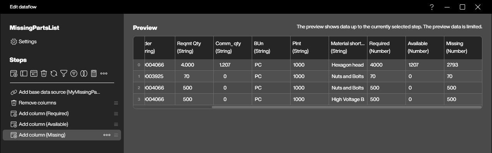
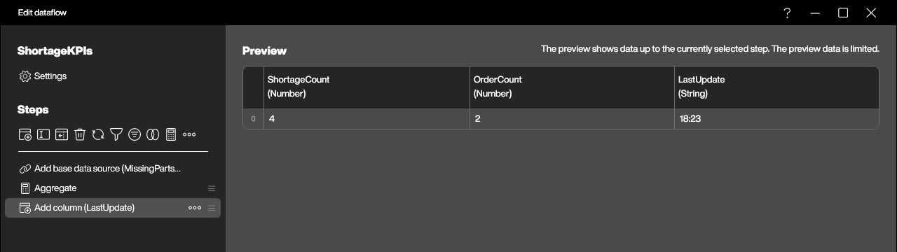
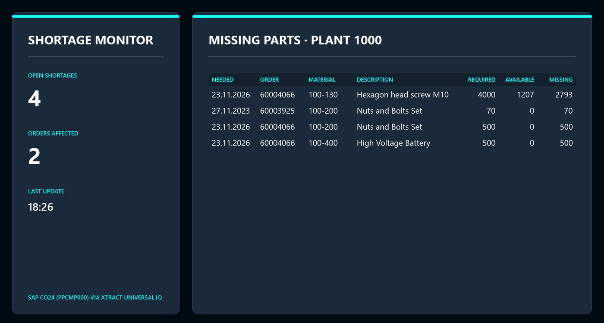

Peakboard has excellent SAP capabilities. The built-in SAP data source calls RFC function modules and BAPIs, reads tables, runs queries and even executes ABAP reports, and we have used all of that many times on this blog. So why would we put another product between Peakboard and SAP?

There are two good reasons to do exactly that with [Xtract Universal.iQ](https://theobald-software.com) (XIQ for short):

* **The customer already runs XIQ in production.** Many companies use Xtract products to feed their data platforms with SAP data, and the services are already built, tested and approved by the SAP team. In that case it makes a lot of sense to consume the same services from Peakboard too, instead of opening a second, parallel path into SAP. One way into SAP, one place to manage authorizations, one team that owns it.
* **The job is something Peakboard can't do easily on its own.** XIQ comes with service types that do a lot of heavy lifting behind the scenes. In this article we look at one of them: the **Report** service, which runs a classic ABAP list report in SAP and turns the printed list into clean JSON.

Our example is a list that every production planner knows and nobody on the shop floor ever sees: the **missing parts list**. We'll look at it in SAP first, then build an XIQ service around it, and finally put it on a Peakboard board that shows the shortages right where the parts are needed.

## The use case: missing parts in SAP

When a production order is released, SAP checks whether all components are available. Every component that can't be fully committed shows up as a missing part. The planner finds these shortages in transaction `CO24`, the *Missing Parts Info System*. Behind the transaction sits the ABAP report `PPCMP000`.

The selection screen offers two blocks: one to select from the reservations and one to select from the orders. For our board we keep it simple and only restrict the plant to `1000`.


The result is a list with one line per missing component. In our sample system there are four of them, three belonging to production order `60004066`. The first line tells the whole story: the order needs 4,000 hexagon head screws, but only 1,207 could be committed. The other components can't be committed at all.


Now let's think about how to get this into Peakboard. There's no released BAPI that returns this list. We could rebuild the logic by reading reservations, stock and order tables and calculating the commitments ourselves, but then we would reimplement the availability check, and that is a road nobody wants to go down. The far better source is the report itself: it already contains exactly the logic the planners trust. The only challenge is that a report doesn't return a table. It returns a printed list. And this is where XIQ comes in.

## Building the service in Xtract Universal.iQ

In XIQ, every piece of SAP data is published as a **service**. A service has a source (the SAP connection), a type, and a destination. For our use case we create a new service called `MissingParts` with the type **Report** and the destination **http-json**, so the result is available as JSON over HTTP. With the **Select Report** button we search for `PPCMP000` and pick it.


Like Peakboard's own report support, the Report service relies on a small helper function module in SAP that executes the report in a background job and fetches the spool. If it isn't installed yet, have a look at [this article](/How-to-make-the-SAP-system-fit-for-report-execution.html).

Now comes the interesting part. A list report is just text, so XIQ has to know where one column ends and the next one starts. The **Detect Columns** button runs the report once and derives the columns from the list header, including their names and lengths. On top of that, we tell XIQ to skip the first three lines (the separator line, the column header and the line below it) and the last line (the closing separator). What's left are the pure data lines.


The selection screen of the report becomes the **Selection Parameters** section. Every select option of `PPCMP000` is listed there, and we fill `S_WERKS` with plant `1000`. One small trap: the report insists on values in both fields, so we set **from** and **to** to `1000`.


That's it. A click on **Run** executes the report in SAP and shows the output. Every line of the list is now a JSON object, and every column of the list is now a property with the column header as its name.


Two details in the output are worth keeping in mind for later. First, the values still carry the padding of the list, like `"   4.000 "`. Second, the quantities are formatted the way SAP prints them for a German user: the dot is the thousands separator, so `4.000` means four thousand, not four.

After saving, the service can be called by any HTTP client. Our XIQ server runs on a machine called `comicbookguy`:

```
GET http://comicbookguy:8080/api/v1/services/MissingParts/run
```

By the way, the **Enable MCP Access** checkbox in the service details publishes the same service as a tool for AI agents. More about MCP in the Peakboard world can be found in our [MCP article](/Open-the-Pod-Bay-Doors-Peakboard-Hub-Learns-to-Speak-MCP.html).

## Building the Peakboard board

The board is available for download at the top of this article. To try it, we replace `comicbookguy` with the name of our own XIQ server. Keep in mind that a Peakboard Box has to be able to reach XIQ over the network too.

### The data source

On the Peakboard side, we don't need anything SAP-specific at all. The XIQ service is just a REST endpoint returning JSON, so we use a regular **JSON data source**. The base URL points to the XIQ server, and the URL path is the `run` endpoint of our service. We let it reload every 300 seconds, which is more than enough for a missing parts list. The preview shows the same four lines we saw in `CO24`.


Peakboard takes over the property names from the JSON as column names. Characters that aren't allowed in a column name are replaced, so `Comm. qty` becomes `Comm_ qty`.

### Converting the quantities in a dataflow

Most of the raw data can go to the screen as it is. The values still carry some trailing blanks, but blanks at the end of a text are invisible in a table, so there's no need to trim them. The quantities are a different story: they are strings in SAP's list format, and we want real numbers to calculate with. A dataflow called `MissingPartsList` takes care of that with just four steps.


The first step removes the columns we don't need, such as the storage location, the MRP controller and the reservation number. This step is more important than it looks. The report has a column called `Item`, and `item` is also the name of the variable that represents the current row in a dataflow script. Having both leads to a conflict, so we drop the column before any script runs.

Then we add two columns of the data type *Number* for the quantities. We remove the blanks and the thousands separator, then turn the decimal comma into a decimal point, and convert the result into a number:

```lua
-- SAP list output: '4.000' means four thousand, decimals use a comma
local s = item['Reqmt Qty'] or ''
s = s:gsub('[%s%.]', '')
s = s:gsub(',', '.')
return tonumber(s) or 0
```

Note the bracket syntax `item['...']`. It's needed whenever a column name contains blanks or special characters. The `Available` column works the same way with `Comm_ qty`. Finally, the `Missing` column is simply the difference of the two:

```lua
return item.Required - item.Available
```

If the SAP user has a different decimal notation, the conversion has to be adjusted accordingly. The decimal notation is a setting in the user's defaults in SAP (transaction `SU3`), and it's the user of the XIQ connection that counts here.

### Feeding the KPI tiles

The left side of the board shows two key figures: the number of open shortages and the number of production orders affected. Instead of looping through the rows in a script, we let a second dataflow do the math. `ShortageKPIs` uses `MissingPartsList` as its source and reloads whenever its source is refreshed, so the tiles are always in sync with the table.

The core of it is a single **Aggregate** step with two functions: **Count** gives us the number of rows as `ShortageCount`, and **Distinct count** on the `Order` column gives us the number of different orders as `OrderCount`. One more *Add column* step adds the time of the last update:

```lua
return date.tostring(data.DateTime.getluadate(), 'HH:mm')
```

We use Peakboard's date functions here instead of Lua's `os.date()`, because they work with the local time of the device.


The result is a list with exactly one row. The text boxes on the screen are bound directly to its values, for example `{ShortageKPIs[0].ShortageCount}` for the number of open shortages. No variables and no scripts needed.

### The result

The right side of the board is a styled table bound to the `MissingPartsList` dataflow, showing the need date, the order, the material, the description and the three quantities. Here's the final board with the four shortages from our sample system:


## Wrapping up

The missing parts list is one of those SAP reports that holds exactly the right information but lives in the wrong place: on the planner's screen instead of next to the assembly line. With the Report service of Xtract Universal.iQ, we turned the report into a JSON endpoint without writing a single line of ABAP, and Peakboard only had to do what it does best: fetch, calculate and visualize.

The same pattern works for many other classic list reports that have no BAPI counterpart. And if the company already uses XIQ for its data platform, the board simply becomes one more consumer of a service that already exists.
