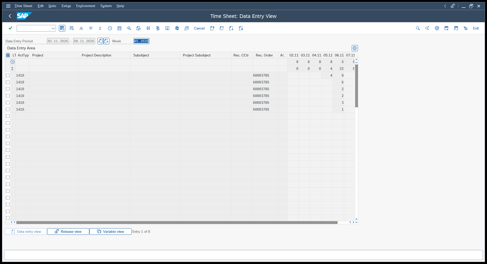
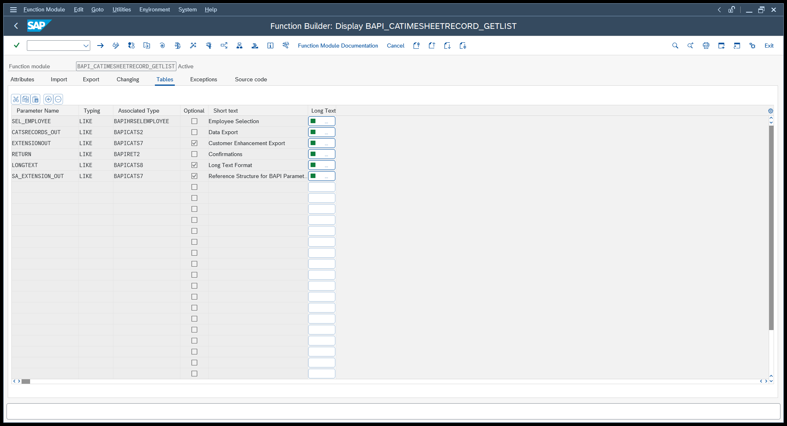
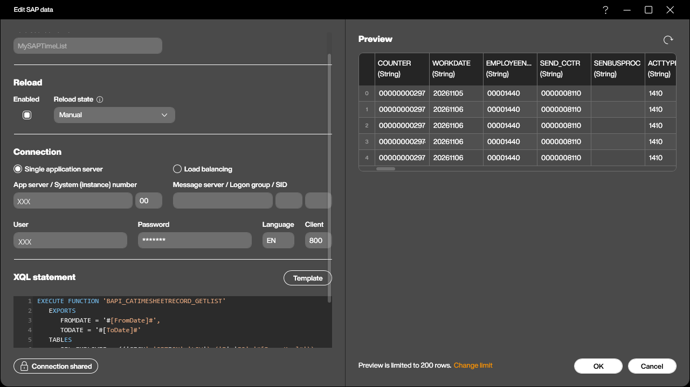
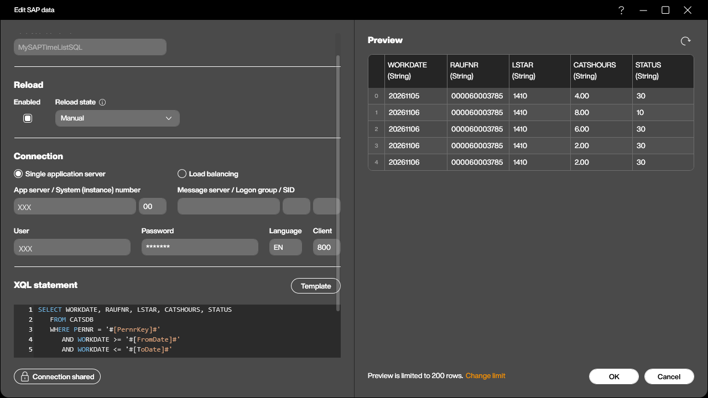
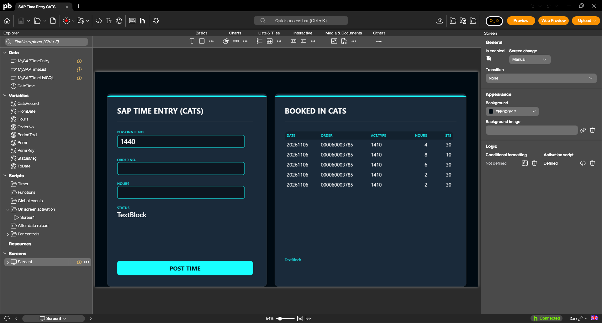
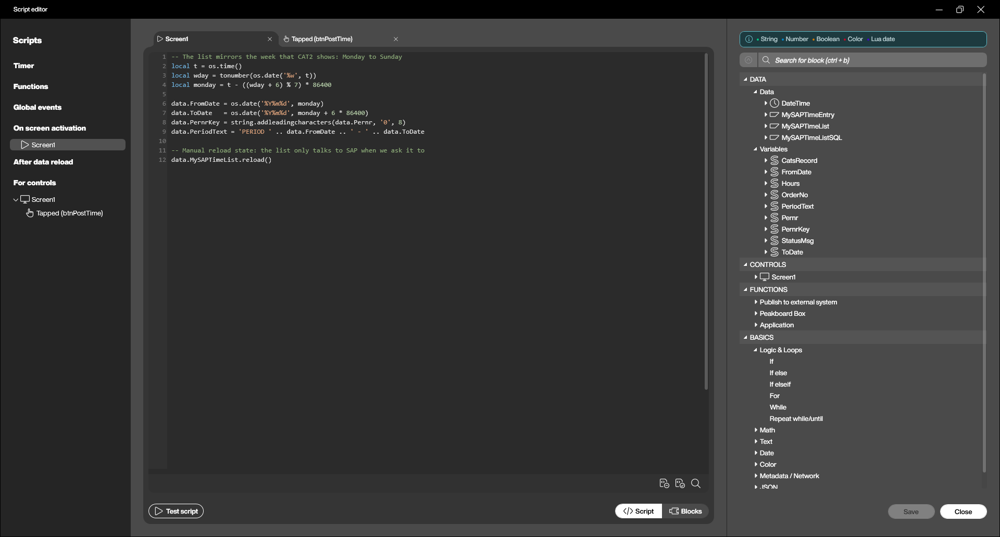
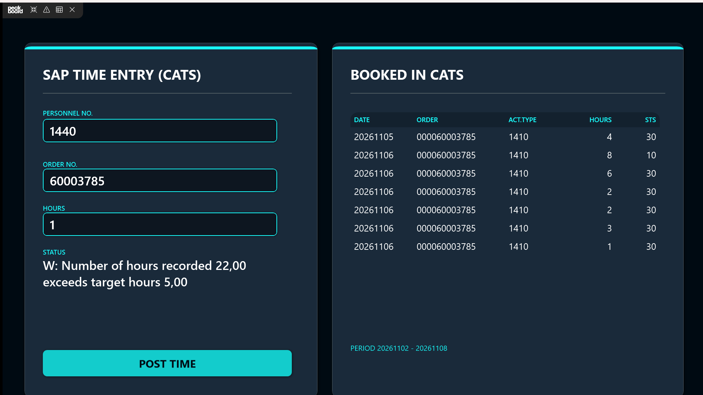

In the [last article](/Nine-Lives-Forty-Hours-Submitting-time-entries-to-SAP-CATS.html) we built a shop floor terminal that posts hours into the SAP Cross-Application Time Sheet. Three fields, one button, and the time is in CATS with the right cost centre and activity type behind it.

That is half of a time sheet. The other half is the question every operator asks the moment the button has been pressed: *and what is on my sheet now?* A posting terminal that only ever swallows input is a letterbox. People trust it a lot more when it shows them what went in - and they notice their own mistakes long before the supervisor does, which is the real win.

So this time we read. We extend the same application with a second card that lists what CATS currently holds for the employee, and we look at the two ways to get that list out of SAP: the BAPI that belongs to the time sheet, and a plain `SELECT` on the table underneath it.

## What SAP shows

Before we read anything over RFC, it helps to look at what we are trying to mirror. Transaction `CAT3` displays a time sheet in exactly the same grid as `CAT2`: one row per receiver object, one column per day of the week, with the daily target hours in the line above and the actual total below.


Two things carry over into everything that follows. First, CATS always thinks in **periods**, never in single records - you ask for an employee and a date range, and you get what is in between. Second, every record has a **processing status**, and that status is the whole story of what happened to it. The values are fixed in the domain `CATSSTATUS`:

| Status | Meaning |
|---|---|
| `10` | In process |
| `20` | Released for approval |
| `30` | Approved |
| `40` | Approval rejected |
| `50` | Changed after approval |
| `60` | Cancelled |

A record that someone typed into `CAT2` and saved sits at `10`. Our terminal posts with `RELEASE_DATA = 'X'`, so its records are released immediately - whether they then stop at `20` or go straight to `30` depends on the approval procedure in the profile's customizing. In our test system nothing stands in the way, and everything the terminal writes comes back as `30` with a Controlling document number already on it. That difference is visible on the screen we are about to build, and it is worth knowing before someone asks why one line looks different from the others.

## The BAPI

The counterpart to `BAPI_CATIMESHEETMGR_INSERT` is **`BAPI_CATIMESHEETRECORD_GETLIST`**. It belongs to function group `BAPICATSRECORD`, it has been released since 1999, and it is remote-enabled - everything we need.


The import side is refreshingly short. `FROMDATE` and `TODATE` are mandatory and define the period; `GET_LONGTEXT` and `TEXT_FORMAT_EXP` are optional and only matter if you want the long texts attached to the records.

The interesting part is in the table parameters:

| Table | Structure | What it is |
|---|---|---|
| `SEL_EMPLOYEE` | `BAPIHRSELEMPLOYEE` | Who to read - mandatory |
| `CATSRECORDS_OUT` | `BAPICATS2` | The records that come back |
| `RETURN` | message table | Remarks, if any |

`SEL_EMPLOYEE` is not a plain list of personnel numbers, it is a **select-options range table**, the same construct you know from any ABAP selection screen. It has four fields - `SIGN`, `OPTION`, `LOW` and `HIGH` - so a row reading `I` / `EQ` / `00001440` means "include, equal to, 1440". The nice consequence is that the same parameter serves the whole range of cases without any extra work: one employee, a handful of them, or everybody between two numbers, just by changing `OPTION` to `BT` and filling `HIGH`.

The records come back in `CATSRECORDS_OUT`, typed on the structure `BAPICATS2` - "CATS Data Export". That structure has **92 fields**, because it has to describe every receiver object CATS knows and every attribute any of them might need. For a cost allocation row we are interested in a very small corner of it:

| Field | Meaning |
|---|---|
| `COUNTER` | The record's own key in the time sheet |
| `WORKDATE` | The day the work was done, as `YYYYMMDD` |
| `EMPLOYEENUMBER` | Personnel number |
| `SEND_CCTR` / `ACTTYPE` | Sending cost centre and activity type |
| `REC_ORDER` | Receiver - here the production order |
| `CATSHOURS` / `UNIT` | Hours and their unit |
| `STATUS` | Processing status from the table above |
| `CATS_DOC_NO` | Document number, once the record has been transferred |

Unlike its writing counterpart, this BAPI changes nothing, so there is no `BAPI_TRANSACTION_COMMIT` to remember this time.

### The call, hard-coded

As in the last article, it pays to write the call out in full before making anything configurable:

```sql
EXECUTE FUNCTION 'BAPI_CATIMESHEETRECORD_GETLIST'
   EXPORTS
      FROMDATE = '20261101',
      TODATE = '20261130'
   TABLES
      SEL_EMPLOYEE = (('SIGN','OPTION','LOW'),('I','EQ','00001440')),
      CATSRECORDS_OUT INTO @RETVAL
```

The table literal follows the rule we already know: the first row holds the column names, every row after it is one record. We only fill `SIGN`, `OPTION` and `LOW` and leave `HIGH` out entirely, because XQL only sends the columns you name in the header.

The new part is `CATSRECORDS_OUT INTO @RETVAL`. Last time we pointed `INTO @RETVAL` at the `RETURN` table because the messages were the only thing we cared about. Here we point it at the payload instead, and the records of the time sheet become the rows of the data source. `RETURN` is not mentioned at all - XQL simply does not ask for it.

### The call, made generic

A fixed personnel number and a fixed month are no use on a terminal, so all three values become placeholders:

```sql
EXECUTE FUNCTION 'BAPI_CATIMESHEETRECORD_GETLIST'
   EXPORTS
      FROMDATE = '#[FromDate]#',
      TODATE = '#[ToDate]#'
   TABLES
      SEL_EMPLOYEE = (('SIGN','OPTION','LOW'),('I','EQ','#[PernrKey]#')),
      CATSRECORDS_OUT INTO @RETVAL
```

This is the same `#[...]#` substitution as last time, but used on single values rather than on a whole table literal - Peakboard replaces the placeholder with the content of the variable as plain text just before the statement goes to SAP, and it does not care whether that text is one word or fifty rows. `PernrKey` holds the personnel number already padded to eight digits, `FromDate` and `ToDate` hold the period in SAP's `YYYYMMDD` form.

The reload state of this data source is **Manual**. Nothing bad happens if it runs on a timer - it is a read - but a terminal that polls SAP every ninety seconds for a list that only changes when somebody presses a button is wasted traffic. We reload it exactly when there is a reason to.


The preview in that screenshot shows the second half of the deal with `BAPICATS2`: you get all 92 columns, whether you want them or not. There is no way to ask a BAPI for a subset of its output structure. That is not a problem - the data source keeps them, the table control on the screen shows the five you bind - but it leads straight to the alternative.

## The other way: straight from CATSDB

Every CATS record lives in table **`CATSDB`**, and XQL can read it directly:

```sql
SELECT WORKDATE, RAUFNR, LSTAR, CATSHOURS, STATUS
   FROM CATSDB
   WHERE PERNR = '#[PernrKey]#'
      AND WORKDATE >= '#[FromDate]#'
      AND WORKDATE <= '#[ToDate]#'
```

Five columns, five columns back, and the field names are the ABAP ones rather than the BAPI's English aliases: `RAUFNR` instead of `REC_ORDER`, `LSTAR` instead of `ACTTYPE`, `PERNR` instead of `EMPLOYEENUMBER`.


So which one should you use? The sample application contains both, as `MySAPTimeList` and `MySAPTimeListSQL`, and they feed the same table control - swap the binding and the screen looks identical. But they are not equivalent, and the BAPI is the better default:

- The BAPI is a **released interface**. Its structure is part of SAP's contract with you and survives upgrades; `CATSDB` is a database table, and nothing stops a future release or a customer enhancement from moving a field.
- The BAPI applies the **CATS logic** - authorization checks, the period handling, the long text assembly. A `SELECT` sees the raw rows and nothing else.
- A select-options table gives you **ranges for free**. Reading a whole department with the BAPI means adding rows to `SEL_EMPLOYEE`; doing the same in SQL means building the `WHERE` clause yourself.

What the `SELECT` gives you in return is precision and a bit of speed: exactly the columns you ask for, and a filter on any field in the table, not just the ones the BAPI exposes as parameters. That matters when you want something the BAPI cannot express - everything above status `30` for a whole plant, say. Reach for it then, and for the normal case stay with the BAPI.

## Building it into the application

The screen grows by one card: a title, a table control bound to `MySAPTimeList`, and a small line underneath showing the period that is on display.


The table shows five columns - date, receiver order, activity type, hours and status. Note that nothing is being prettified here: `20261106` is exactly what the BAPI returned, and the order number comes back padded to its internal twelve digits. On a real terminal you would clean that up in the `DataRowLoaded` event or in a dataflow, but for an article it is more honest to show what SAP actually hands over.

Three variables feed the call, and they are set in the screen's **activation script**, which runs once when the screen comes up:

```lua
-- The list mirrors the week that CAT2 shows: Monday to Sunday
local t = os.time()
local wday = tonumber(os.date('%w', t))
local monday = t - ((wday + 6) % 7) * 86400

data.FromDate = os.date('%Y%m%d', monday)
data.ToDate   = os.date('%Y%m%d', monday + 6 * 86400)
data.PernrKey = string.addleadingcharacters(data.Pernr, '0', 8)
data.PeriodText = 'PERIOD ' .. data.FromDate .. ' - ' .. data.ToDate

-- Manual reload state: the list only talks to SAP when we ask it to
data.MySAPTimeList.reload()
```

The weekday arithmetic is the only part that needs a second look. `os.date('%w')` returns `0` for Sunday through `6` for Saturday, so `(wday + 6) % 7` is the number of days back to Monday: zero on a Monday, six on a Sunday. Subtract that many days and you are on the first day of the week CATS would show you, add six and you are on the last.


The second half of the wiring is two lines at the end of the **POST TIME** script from the last article:

```lua
-- Refresh the list card so the new record shows up right away
data.PernrKey = string.addleadingcharacters(data.Pernr, '0', 8)
data.MySAPTimeList.reload()
```

The first line is not redundant: the operator may have typed a different personnel number since the screen came up, and the list should follow whoever just posted. The second closes the loop.

## Trying it out

Start the preview, post a couple of hours the way we did last time, and the new record appears in the list card a moment later - read back out of SAP, not simulated locally.


The screenshot repays a close look. All the records our terminal wrote sit at status `30` - approved, and in `CATSDB` they already carry a Controlling document number. The one line at `10` is the record that was typed into `CAT2` by hand and saved without releasing it - the same employee, the same day, the same order, and a completely different place in the process. That is exactly the kind of thing an operator spots in two seconds on a screen and never spots in a time sheet grid they do not have access to.

And the warning in the status line is still there: `W: Number of hours recorded 22,00 exceeds target hours 5,00`. Our test employee has had a long day.

## Wrapping up

The terminal now does both directions over the same connection: it writes hours into CATS through one BAPI and reads them back through another, with the table underneath as a fallback when the BAPI's output is more than you want to carry.

From here, the useful next step is less code than context. Once the personnel number comes from a badge instead of a keyboard - as sketched at the end of the [posting article](/Nine-Lives-Forty-Hours-Submitting-time-entries-to-SAP-CATS.html) - the list card stops being a confirmation and becomes something closer to a personal dashboard: scan in, see your week, book the job, see it land. Nobody has to go looking for a PC to find out whether yesterday's hours made it.
